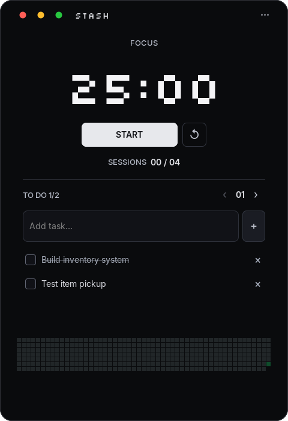

<div align="center">


# Stash

**A minimal desktop focus timer built with C++17 and GTK 3.**

Focus on your work, organize tasks by session, and keep your timer visible while you study or code.


</div>

## Overview

Stash is a lightweight productivity app with a distraction-free black interface, a pixel-style countdown, Inter text, and checklists for individual focus sessions. An unlabeled contribution calendar keeps a daily history of your completed focus time.

The app runs locally, automatically saves your plan, and does not require an account or a web service.

## Preview



You can generate updated screenshots using the desktop smoke test described under [Testing](#testing).

## Features

- **Pomodoro cycle:** 25-minute focus, 5-minute short break, and 15-minute long break by default. A long break follows every fourth completed focus session.
- **Customizable plans:** Set 1–99 focus sessions and configure focus/break durations from 1–180 minutes.
- **Per-session tasks:** Add, complete, uncheck, or delete tasks for each session. Browse other session lists without interrupting the running timer.
- **Automatic transitions:** Once started, the timer progresses between focus and breaks until the plan is complete. Pause or reset whenever needed.
- **Contribution calendar:** An unlabeled, Sunday-first grid shows 53 weeks with larger, denser squares in expanded and fullscreen views. Only completed focus sessions contribute time; brighter green squares mean more focus hours that day. Hover over a square to see its date and focus time.
- **Pixel hourglass icon:** A black-and-white, 8-bit hourglass identifies Stash in your taskbar, shortcuts, and desktop launcher.
- **Simple typography:** Bundled Inter uses medium weight for section labels and semibold for primary buttons and counts. Task text stays regular, with the original Silkscreen pixel font preserved for the countdown and app name.
- **Minimal window controls:** Three small Apple-style circles handle close, minimize, and fullscreen. The fullscreen header shows only Settings.
- **Multiple window modes:** Expanded, resizable, fullscreen, and a compact 360 × 360 floating panel (subject to desktop/window-manager support).
- **Sound notifications:** A warning at 10 seconds remaining and a completion chime, with selectable Windows or Linux/WSLg output.
- **Auto-save:** Stores your session progress, daily focus history, task lists, timing preferences, and audio settings across launches.
- **Offline-friendly:** Core functionality is local, with no account, cloud sync, or continuous background service.

## Tech Stack

| Component                | Technology                                              |
| ------------------------ | ------------------------------------------------------- |
| Language                 | C++17                                                   |
| Desktop UI               | GTK 3                                                   |
| Build system             | CMake 3.16+                                             |
| Styling                  | CSS, bundled Silkscreen and Inter fonts                  |
| Audio                    | PulseAudio / ALSA (Linux), WinMM (Windows), WSL interop |
| Supported source targets | Linux, WSLg, Windows via MSYS2                          |

> **Platform note:** Linux and native Windows use the same calendar, persistence, and bundled fonts. The Windows installer builds the app and runs its native automated tests; the verification script checks the installed desktop app, audio output, and shortcuts.

## Getting Started

### Linux / Ubuntu / Debian (including WSLg)

**1. Install build dependencies**

```bash
sudo apt update
sudo apt install build-essential cmake pkg-config libgtk-3-dev libfontconfig1-dev
```

For Linux/WSLg audio, also install:

```bash
sudo apt install libpulse0
```

**2. Open the project directory**

If you cloned the repository, `cd` into the folder containing `run.sh` and `CMakeLists.txt`.

**3. Run the application**

```bash
./run.sh
```

Or compile it manually:

```bash
cmake -S . -B build -DCMAKE_BUILD_TYPE=Release
cmake --build build --parallel
./build/stash
```

A graphical Linux desktop or WSLg session is required to display the interface. The Linux launcher can also provision a local PulseAudio runtime if the system library is missing.

### Windows native installation

Install [MSYS2](https://www.msys2.org/) at `C:\msys64`, then double-click **`install-windows.bat`** in this project. The installer updates MSYS2, installs the build dependencies, builds the Windows app, and runs its automated tests. Set `MSYS2_ROOT` first if MSYS2 is installed elsewhere.

The app is installed for your Windows account at `%LOCALAPPDATA%\Programs\Stash\stash.exe`, with **Stash** shortcuts on the Desktop and in the Start Menu. The shortcuts open the native `.exe` directly without a terminal. GTK and the required runtime DLLs are bundled beside the app; launching the installed app does not need WSL or MSYS2.

The Windows build requires Pango 1.56 or newer (included with current MSYS2 packages). It loads the bundled Silkscreen timer font and Inter text font directly into Pango's font map, so GTK uses the same faces as WSL without installing fonts system-wide. Version **1.4.3** includes a simplified black-and-white pixel hourglass, a bolder contribution calendar, refined text weights, Apple-style window controls, and a Settings-only fullscreen header. The name and version are also embedded in the Windows executable's properties.

To reinstall after source changes, close Stash and run `install-windows.bat` again. The installer replaces the old Quiet Pomodoro shortcuts with Stash shortcuts. Saved tasks, preferences, and calendar history are kept separately in `%LOCALAPPDATA%\quiet-pomodoro\state.ini`.

For a build with dependencies already installed, or to import existing settings only when Windows has no saved state:

```powershell
powershell -NoProfile -ExecutionPolicy Bypass -File .\tools\install_windows.ps1 -Launch
powershell -NoProfile -ExecutionPolicy Bypass -File .\tools\install_windows.ps1 -StateFile "C:\path\to\state.ini"
```

The installer also works from a WSL source folder: invoke `powershell.exe` with the script's Windows UNC path (`wslpath -w tools/install_windows.ps1`). Compilation takes place in a temporary Windows folder.

### Windows development (MSYS2)

1. Install [MSYS2](https://www.msys2.org/) and open the **UCRT64** terminal.
2. Install the required packages:

```bash
pacman -S --needed mingw-w64-ucrt-x86_64-gcc mingw-w64-ucrt-x86_64-cmake mingw-w64-ucrt-x86_64-ninja mingw-w64-ucrt-x86_64-pkgconf mingw-w64-ucrt-x86_64-gtk3
```

3. In the project directory, build and run:

```bash
cmake -S . -B build-windows -G Ninja -DCMAKE_BUILD_TYPE=Release
cmake --build build-windows
./build-windows/stash.exe
```

Alternatively, `run-windows.bat` builds and launches the app after dependencies are installed. It assumes MSYS2 is located at `C:\msys64`; otherwise, set `MSYS2_ROOT`.

The executable needs GTK runtime dependencies if moved to another PC. See [GTK's Windows installation guide](https://www.gtk.org/docs/installations/windows/).

## How to Use

1. Open **··· Settings** and choose your focus-session target and timer durations.
2. Under **TO DO**, choose a session using **‹ / ›** and add tasks with **Enter** or **+**.
3. Press **START** to begin your focus timer.
4. Mark individual tasks as complete as you work. The timer will move automatically to the appropriate break.
5. When you complete your final focus session, select **NEW PLAN** to restart the session count while keeping your task text and settings.

> Completing a timer marks the **session** as finished; tasks are marked complete only when you check them off yourself.

Each completed focus interval adds its duration to the calendar on the local date it finishes. For example, completing the first 25-minute session in a six-session plan (1/6) records 25 minutes; completing all six records 2 hours 30 minutes. Starting, pausing, resetting an unfinished timer, and taking breaks add no time. Starting a new plan keeps your history.

The four green levels represent under 1 hour, 1–2 hours, 2–4 hours, and 4 or more hours of completed focus time in a day. Days with no completed focus time stay dark. There are no visible calendar titles, month/day labels, or legends; details appear only on hover. Compact mode keeps its small timer and task layout.

## Keyboard Shortcuts

| Shortcut         | Action                                                    |
| ---------------- | --------------------------------------------------------- |
| `Space`          | Start / pause timer (when not editing a field)            |
| `R`              | Reset the current timer or restart a completed plan       |
| `M`              | Toggle compact / expanded view                            |
| `F11`            | Toggle fullscreen                                         |
| `Esc`            | Exit fullscreen, dismiss settings, or expand compact view |
| `Left` / `Right` | Browse session task lists                                 |
| `Enter`          | Add a task while editing the task field                   |
| `Ctrl + H`       | Hide to taskbar                                           |
| `Ctrl + Q`       | Close application                                         |

The red window control closes the app, yellow minimizes it to the taskbar, and green enters fullscreen. In fullscreen, the header shows only **··· Settings**; exit with `Esc`, `F11`, or **Settings → EXIT FULLSCREEN**. Switch between the compact panel and expanded window using `M` or the mode button in Settings. Settings is available in both window sizes.

On some Wayland desktops, always-on-top behavior and requested window dimensions are controlled by the compositor.

## Audio & Troubleshooting

Audio cues are generated in the app; no separate audio files are downloaded. Choose **Automatic**, **Windows speakers**, or **Linux / WSLg audio** in settings and press **TEST SOUND**.

From a WSL/Linux terminal, test the saved output preference:

```bash
./run.sh --test-sound
```

To test a specific output without fallback:

```bash
./run.sh --test-sound --output=windows
./run.sh --test-sound --output=linux
./run.sh --test-sound --output=auto
```

On WSL, automatic playback tries the Windows output first, then WSLg PulseAudio if needed. If no output works, open **AUDIO ERROR DETAILS** in the app or review terminal output. Windows audio bridging requires working `powershell.exe` interop; Linux/WSLg audio needs the PulseAudio runtime. Audio may also be muted at the operating-system level.

## Saving Your Progress

Session tasks, completion status, plans, daily focus history, duration settings, and audio preferences are automatically saved to:

| System      | Saved state                                                                           |
| ----------- | ------------------------------------------------------------------------------------- |
| Linux / WSL | `~/.config/quiet-pomodoro/state.ini` (or `$XDG_CONFIG_HOME/quiet-pomodoro/state.ini`) |
| Windows     | `%LOCALAPPDATA%\quiet-pomodoro\state.ini`                                             |

The next unfinished session is prepared when the app reopens, but an active countdown itself is not resumed. Use one running instance at a time. To reset saved data completely, close the app and delete its `state.ini` file.

Stash retains the previous `quiet-pomodoro` save folder for compatibility, so renaming the app preserves existing tasks, preferences, and history.

Calendar history is stored as completed focus seconds per local date in the `[activity]` section of the same file. History survives restarts, date changes, and new plans. Existing installations start with an empty calendar because older saves did not retain dated focus durations; existing tasks and settings are preserved.

## Project Structure

```text
src/
  main.cpp                  # Desktop interface and window behavior
  timer.hpp                 # Countdown and Pomodoro phase cycle
  plan.hpp                  # Session target and progress
  storage.*                 # Tasks, settings, and persistence
  activity.*                # Daily focus history, calendar dates, highlight levels
  font.*                    # App-local font registration
  audio.*                   # Queued playback and audio outputs
  audio_samples.hpp         # Generated tones / WAV data
  windows_audio_script.hpp # Windows audio bridge
assets/
  style.css                 # Interface styling
  stash.svg / .png / .ico    # Black-and-white pixel hourglass for Linux, GTK, and Windows
  ...                       # Font, license, icon, desktop launcher
tests/                       # Automated tests
tools/setup_audio.py         # Linux audio runtime setup
run.sh                       # Linux / WSL launcher
run-windows.bat               # Windows launcher
install-windows.bat           # Native Windows installation and shortcuts
tools/install_windows.ps1     # Per-user Windows installer
tools/build_windows.sh        # Windows build, tests, and runtime packaging
tools/build_icons.py          # Regenerate PNG/ICO from the pixel hourglass SVG
CMakeLists.txt                # CMake build configuration
```

## Testing

Run automated tests after building:

```bash
ctest --test-dir build --output-on-failure
```

Tests cover timer behavior, phase transitions, session plans, daily focus totals, calendar dates and hour thresholds, persistence, audio handling, and actual bundled-font selection. An optional graphical smoke test checks window layouts, tasks, and completed-session recording:

To verify the installed Windows package, run:

```powershell
powershell -NoProfile -ExecutionPolicy Bypass -File .\tools\verify_windows.ps1
```

This checks native audio, desktop behavior, and both shortcuts with WSL/MSYS2 runtime paths removed. It uses an isolated test profile and keeps logs and screenshots in the Windows temporary folder.

For the Linux graphical smoke test:

```bash
QUIET_SMOKE_CONFIG="$(mktemp -d)" ./build/stash --smoke-test
```

Run this from the project root within a graphical session. The smoke test may generate preview screenshots such as `docs/main.png`, `docs/compact.png`, and `docs/expanded.png` (plus additional views where supported).

## Credits

The app includes [Silkscreen](https://github.com/googlefonts/silkscreen) by the Silkscreen Project Authors, licensed under the **SIL Open Font License 1.1**. The bundled font and its license are located at `assets/Silkscreen-Regular.ttf` and `assets/Silkscreen-OFL.txt`.

The app also includes [Inter](https://github.com/google/fonts/tree/main/ofl/inter) by the Inter Project Authors for interface text across platforms, licensed under the **SIL Open Font License 1.1**. The bundled font and license are located at `assets/Inter.ttf` and `assets/Inter-OFL.txt`.

## License

No license for the application source code is specified in the provided project documentation. Add a root `LICENSE` file if you intend to publish the source under an explicit license. The bundled fonts retain their separate licenses listed above.
